# Лабораторная работа №4. Облачные сети. Amazon VPC

| | |
| --- | --- |
| **Студент** | Klincev Andrei |
| **Группа** | IA2403 |
| **Специальность** | Informatică aplicată |
| **Номер `k`** | 21 |
| **Уровень** | Продвинутый (Часть 1 и Часть 2, задания 1–14) |
| **Приложение** | TimeCapsule, PHP без фреймворка + PostgreSQL 16 |
| **Вариант деплоя** | A: вручную на сервере (`git pull` + команды) |
| **Репозиторий приложения** | <https://github.com/Coffee-Cloud-Computing/lab2> |
| **Репозиторий отчёта** | <https://github.com/Coffee-Cloud-Computing/lab4> |
| **Регион** | `us-east-1` |

### Имена и теги

| Ключ | Значение |
| --- | --- |
| `Name` | имя по шаблону, например `timecapsule-dev-vpc` |
| `Project` | `timecapsule` |
| `Environment` | `dev` |
| `Owner` | `coffee` |
| `Lab` | `lab4` |

### Часть 1. Базовый уровень

#### Задание 1. Бакет и объекты в консоли

1. Создайте бакет timecapsule-dev-uploads-<nickname>: тип General purpose, ACLs disabled, Block all public access, версионирование пока выключено, шифрование SSE-S3, обязательные теги. 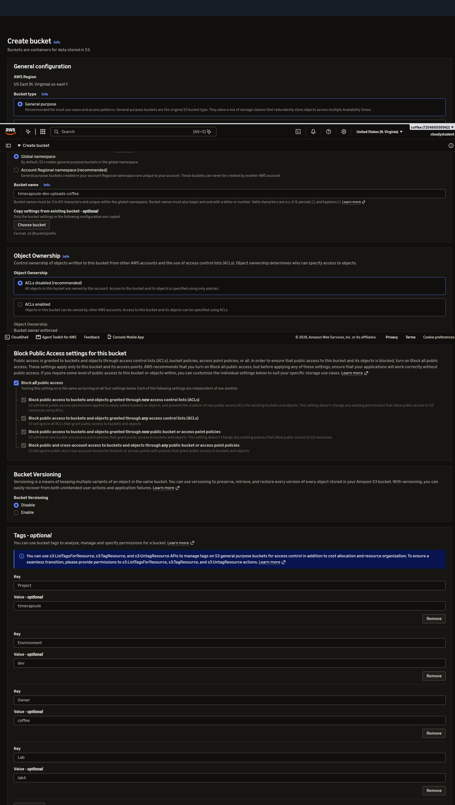
2. Загрузите файлы. Создайте папку uploads и загрузите в неё любую картинку и любой PDF. Создайте папку backups и загрузите в неё любой текстовый файл.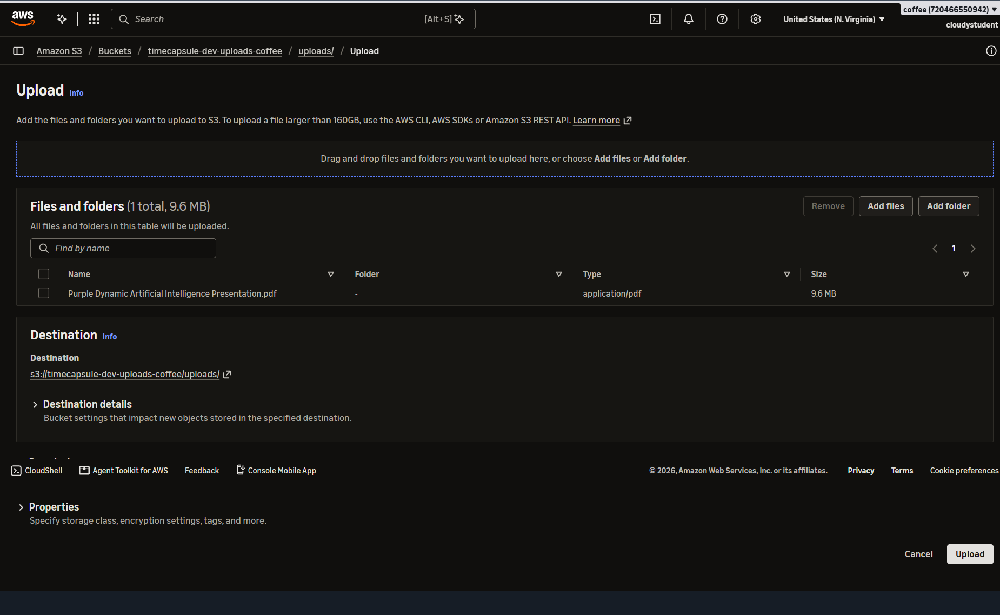

#### Задание 2. Объекты из командной строки

1. Открываем CloudShell и сохраняем имя бакета в переменную. Переменная живёт до закрытия CloudShell: в новом сеансе выполните эту строку ещё раз.
2. Создайте и загрузите файлы:
   1. Создайте и загрузите файлы:
    ```cmd
    mkdir -p lab4/2026/10 && cd lab4
    echo "photo placeholder" > photo.txt
    echo "october report"    > 2026/10/report.txt
    echo "october report 2"  > 2026/10/report-2.txt
    aws s3 cp photo.txt s3://$BUCKET/uploads/photo.txt
    aws s3 sync 2026 s3://$BUCKET/uploads/2026
    ```
   2. Посмотрите содержимое бакета тремя способами и сравните вывод: 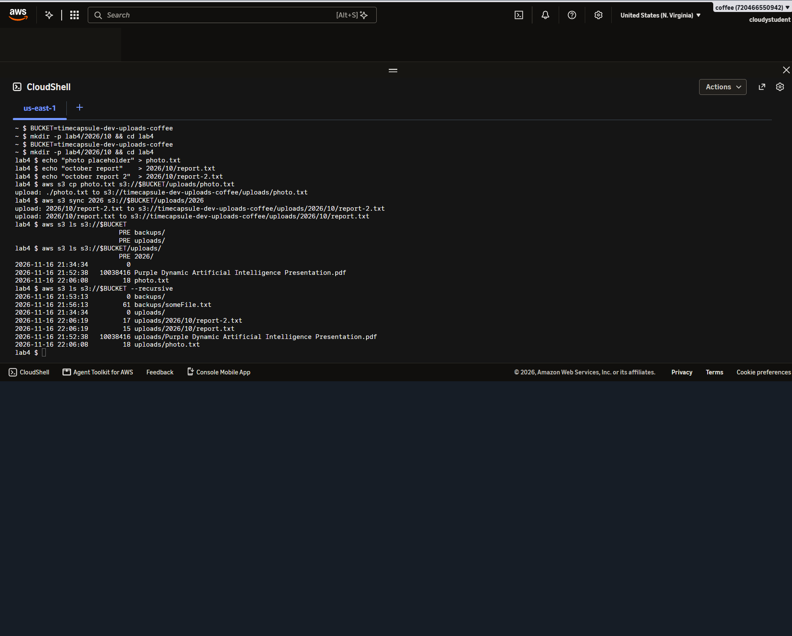
   3. Читаем метаданные картинки из задания 1 и файла uploads/2026/10/report.txt, не скачивая их: `aws s3api head-object --bucket $BUCKET --key <ключ>`. Если в имени картинки есть пробелы, возьмите ключ в кавычки.
   ```aws
    lab4 $ aws s3api head-object --bucket $BUCKET --key uploads/2026/10/report.txt
    {
        "AcceptRanges": "bytes",
        "LastModified": "2026-11-16T22:06:19+00:00",
        "ContentLength": 15,
        "ETag": "\"b226e1a3649a6073b10d77b8cc66d8f5\"",
        "ContentType": "text/plain",
        "ServerSideEncryption": "AES256",
        "Metadata": {}
    }
    lab4 $ aws s3api head-object --bucket $BUCKET --key uploads/jezva.png

    aws: [ERROR]: An error occurred (404) when calling the HeadObject operation: Not Found
    lab4 $ aws s3api head-object --bucket $BUCKET --key uploads/jezva.jpg
    {
        "AcceptRanges": "bytes",
        "LastModified": "2026-11-16T22:22:45+00:00",
        "ContentLength": 32112,
        "ETag": "\"f5a964961ca63258631a2344bff9ea3a\"",
        "ContentType": "image/jpeg",
        "ServerSideEncryption": "AES256",
        "Metadata": {}
    }
   ```
   4. Скачайте один объект и удалите другой:
    ```cmd
    lab4 $ aws s3 cp s3://$BUCKET/uploads/photo.txt downloaded.txt && cat downloaded.txt
    download: s3://timecapsule-dev-uploads-coffee/uploads/photo.txt to ./downloaded.txt
    photo placeholder
    lab4 $ aws s3 rm s3://$BUCKET/uploads/2026/10/report-2.txt
    delete: s3://timecapsule-dev-uploads-coffee/uploads/2026/10/report-2.txt
    lab4 $ 
    ```

#### Задание 3. Политика бакета: только HTTPS

1. Добавьте политику бакета (Permissions → Bucket policy), которая запрещает (Deny) любому участнику ("Principal": "*") любые действия с бакетом и его объектами, если запрос пришёл не по HTTPS. Используйте условие "Bool": { "aws:SecureTransport": "false" }. В Resource укажите два ARN: бакета и его объектов (.../*).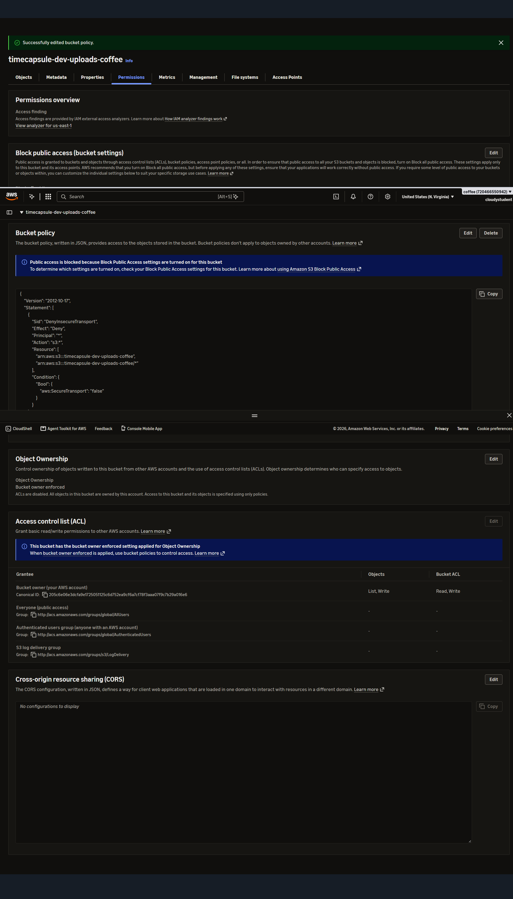
2. Проверьте политику в CloudShell. Параметр --endpoint-url во второй команде заставляет CLI обращаться к S3 по http://:

   ```cmd
    $ aws s3 ls s3://$BUCKET/uploads/
                            PRE 2026/
    2026-11-16 21:34:34          0 
    2026-11-16 21:52:38   10038416 Purple Dynamic Artificial Intelligence Presentation.pdf
    2026-11-16 22:22:45      32112 jezva.jpg
    2026-11-16 22:06:08         18 photo.txt
    $ aws s3 ls s3://$BUCKET/uploads/ --endpoint-url http://s3.us-east-1.amazonaws.comaws: [ERROR]: An error occurred (AccessDenied) when calling the ListObjectsV2 operation: User: arn:aws:iam::720466550942:user/cloudystudent is not authorized to perform: s3:ListBucket on resource: "arn:aws:s3:::timecapsule-dev-uploads-coffee" with an explicit deny in a resource-based policy
    ~ $  
    ```

    > Вторая команда отправляет запрос по HTTP, поэтому ключ aws:SecureTransport равен false, и срабатывает явный запрет в политике бакета, который действует на любого участника ("Principal": "*"). При проверке прав AWS явный Deny всегда сильнее любого Allow, поэтому права администратора не помогают. Block Public Access не помешал сохранить политику, потому что он блокирует только политики, которые открывают доступ публично, а эта политика ничего не разрешает, только запрещает.

#### Задание 4. Версионирование и защита от удаления

1. Включите версионирование: Properties → Bucket Versioning → Edit → Enable → Save changes 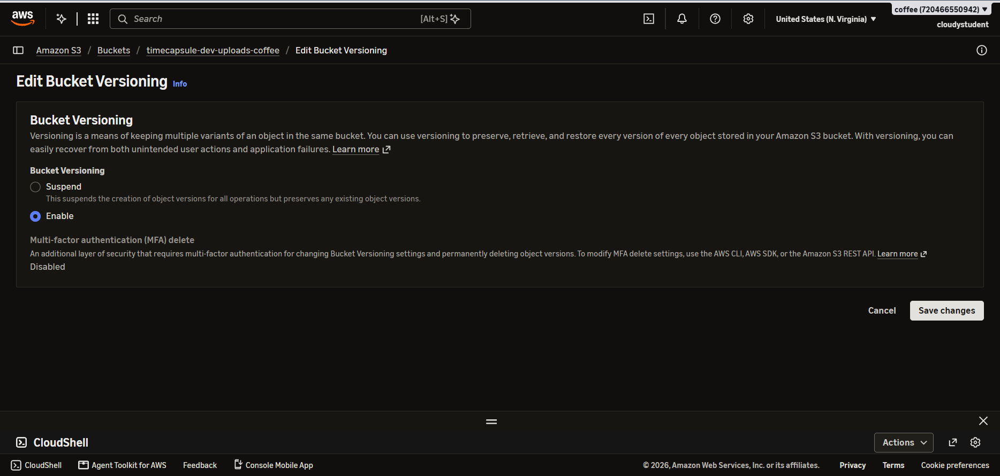. На вкладке Objects включите переключатель Show versions и видим что у ранее добаленных файлов идентификатор версии файлов `null`
2. Создаём историю. Создаём на своём компьютере файл notes.txt с текстом v1 и загрузите его в uploads/. Затем замените текст на v2 и загрузите файл ещё раз под тем же именем.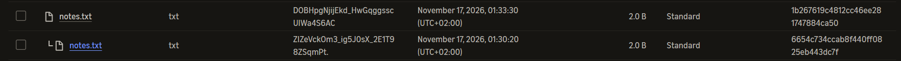
3. Удаляем объект при выключенном Show versions. Файл notes.txt исчезнет из списка. Включаем Show versions и смотрим, что на самом деле произошло с объектом. 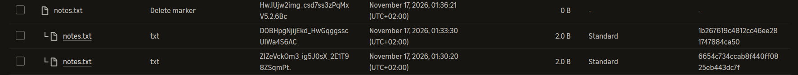
4. Восстановите объект. При включённом Show versions удалите маркер удаления (Delete marker) и проверьте, что notes.txt вернулся с текстом v2.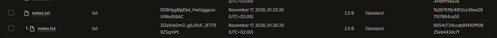
5. Откатитываемся к v1. При включённом Show versions удаляем версию v2. Обратите внимание, что консоль просит подтвердить это удаление иначе, чем в шаге 3. Проверьте, что текущей стала версия v1. 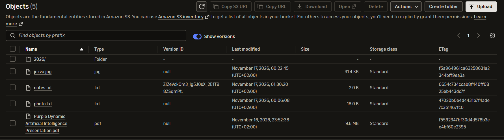

> Удаление в с включённым show versions и выключенным отличается в возможности отката версии назад, при удалении с выключенным версионированием файл не удаляется, он лишь помечается как "deleted" а при включённым show versions конкретный файл удаляется безповоротно (permanently delete)

#### Задание 5. Правило жизненного цикла
Настраиваем правило, которое не даёт истории версий расти бесконечно. Management → Create lifecycle rule:

* Lifecycle rule name: timecapsule-dev-noncurrent.
* Область действия: только префикс uploads/. Объекты в backups/ правило не затрагивает.
* Неактуальные версии переходят в Standard-IA через 30 дней.
* Неактуальные версии удаляются через 90 дней, кроме двух самых новых из них (Number of newer versions to retain: 2).
* Незавершённые загрузки частями (incomplete multipart uploads) удаляются через 7 дней.


> Наши тестовые файлы весят несколько байт или килобайт. По умолчанию S3 не переводит объекты меньше 128 КБ в другие классы хранения: плата за переход и минимальный оплачиваемый размер объекта в Standard-IA (128 КБ) съели бы всю экономию. Поэтому правило их просто пропустит, а удаление через 90 дней к ним всё равно применится.

#### Задание 6. Подписанные URL

1. Ссылка из консоли. Создайте для картинки из задания 1 подписанную ссылку на 5 минут (Object actions → Share with a presigned URL) и откройте её в приватном окне браузера.
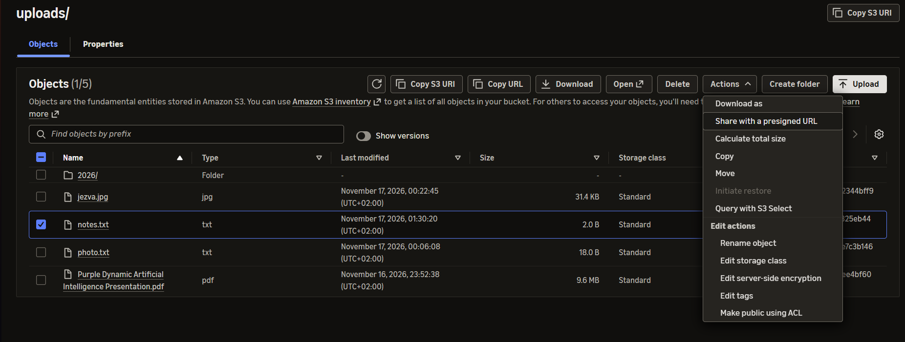
2. Ссылка из CLI. Создайте ссылку на uploads/photo.txt сроком 2 минуты и откройте её:

```cmd
aws s3 presign s3://$BUCKET/uploads/photo.txt --expires-in 120
```
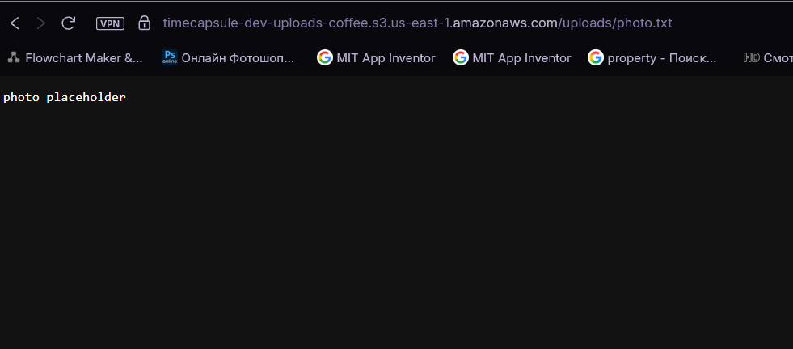

3.  Измените ссылку. Замените в адресе photo.txt на notes.txt (такой объект в бакете есть) и откройте получившийся адрес.
4. Дождитесь окончания срока. Через 2 минуты после создания откройте исходную ссылку из шага 2 ещё раз. 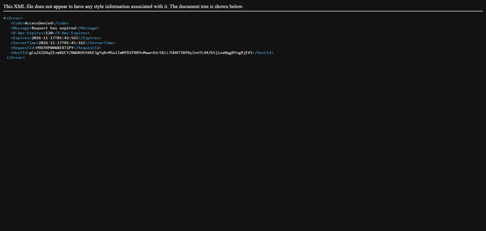

> В шаге 3 S3 вернул SignatureDoesNotMatch, в шаге 4 — AccessDenied с сообщением Request has expired. Подпись вычисляется от метода, ключа объекта, срока действия и других параметров запроса, поэтому любое изменение ключа делает её недействительной, а без секретного ключа новую подпись не создать. Команда aws s3 presign к S3 не обращалась: подпись считается локально из учётных данных пользователя.

### Часть 2. Продвинутый уровень

#### Задание 7

1. Подготавлваем политику для пользователя
```json
{
  "Version": "2012-10-17",
  "Statement": [
    {
      "Sid": "ListUploadsPrefix",
      "Effect": "Allow",
      "Action": "s3:ListBucket",
      "Resource": "arn:aws:s3:::timecapsule-dev-uploads-coffee",
      "Condition": {
        "StringLike": { "s3:prefix": ["uploads/*"] }
      }
    },
    {
      "Sid": "ReadWriteUploadsObjects",
      "Effect": "Allow",
      "Action": ["s3:GetObject", "s3:PutObject", "s3:DeleteObject"],
      "Resource": "arn:aws:s3:::timecapsule-dev-uploads-coffee/uploads/*"
    }
  ]
}
```

2. Составьте документ политики IAM.
    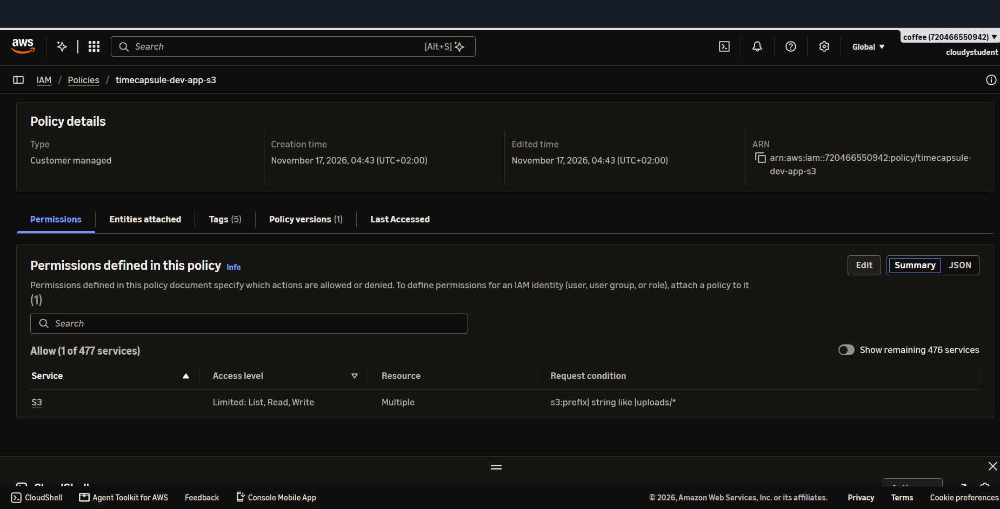

> s3:ListBucket — это операция над самим бакетом: она возвращает список его содержимого, поэтому её ресурс — ARN бакета (arn:aws:s3:::имя). s3:GetObject, PutObject и DeleteObject работают с отдельными объектами, поэтому их ресурс — ARN объектов (arn:aws:s3:::имя/uploads/*). Если перепутать ARN, ни одно правило не совпадёт с запросом: AWS сопоставит ListBucket с ARN объектов, а GetObject с ARN бакета и не найдёт разрешения. Сработает неявный запрет, и все команды получат AccessDenied. Сохранить такую политику при этом удастся: IAM в лучшем случае покажет предупреждение.

#### Задание 8. Проверка прав через тестовую роль

1. Чтобы проверить политику, нужен кто-то, у кого есть только она. Ваш пользователь для этого не подходит: у него права администратора.

* Создайте тестовую роль. IAM → Roles → Create role:
* Trusted entity type: AWS account, вариант This account.
* Permissions policies: только timecapsule-dev-app-s3.
* Role name: timecapsule-dev-s3-tester, обязательные теги.

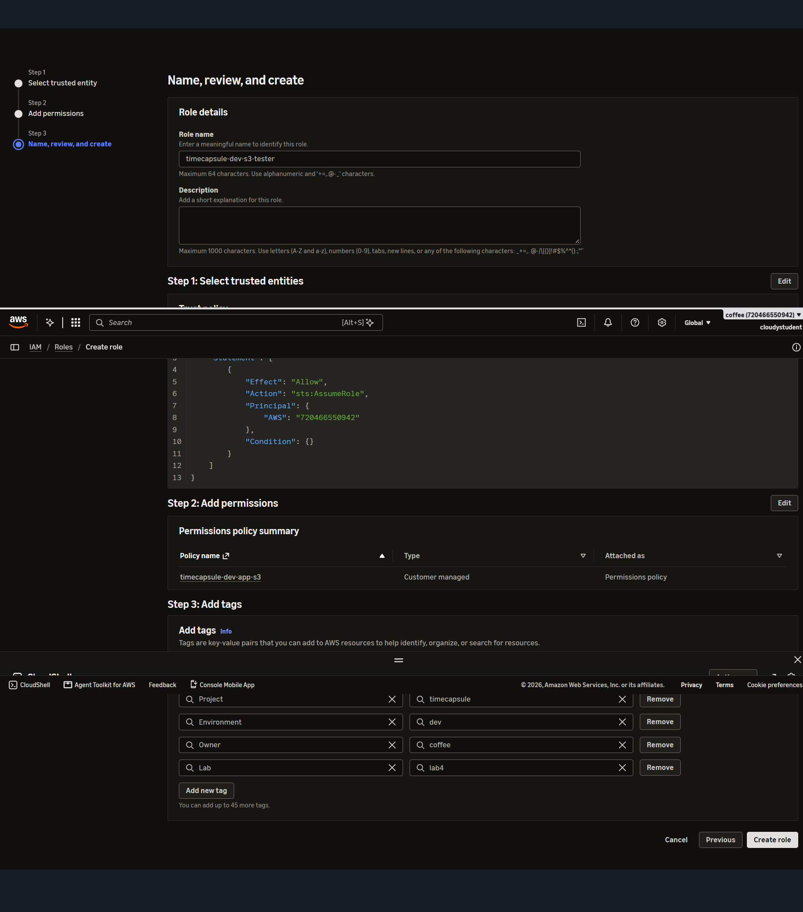

2. Возьмите роль на себя в CloudShell. Команда aws sts assume-role выдаёт временные учётные данные роли, а вторая часть команды записывает их в переменные окружения, которые CLI использует вместо ваших:
```cmd
~ $ BUCKET=timecapsule-dev-uploads-coffee
~ $ ROLE_ARN=arn:aws:iam::$(aws sts get-caller-identity --query Account --output text):role/timecapsule-dev-s3-tester
~ $ eval $(aws sts assume-role --role-arn $ROLE_ARN --role-session-name lab4 \
>  --query 'Credentials.[AccessKeyId,SecretAccessKey,SessionToken]' --output text \
>  | awk '{print "export AWS_ACCESS_KEY_ID="$1" AWS_SECRET_ACCESS_KEY="$2" AWS_SESSION_TOKEN="$3}')
~ $ aws sts get-caller-identity
{
    "UserId": "AROA2PPZHECPGD65XZTYR:lab4",
    "Account": "720466550942",
    "Arn": "arn:aws:sts::720466550942:assumed-role/timecapsule-dev-s3-tester/lab4"
}
```

В поле `Arn` должна быть строка вида `arn:aws:sts::<аккаунт>:assumed-role/timecapsule-dev-s3-tester/lab4`. Учётные данные действуют один час: если команды начали получать `ExpiredToken`, выполните шаг 4 и возьмите роль заново.

3. Проверьте права. Прежде чем выполнять команды, заполните в отчёте колонку "Ожидаю": разрешено или AccessDenied. Затем выполните команды и заполните колонку "Получил". Если ожидание не совпало с результатом, объясните причину.

Для команды 8 нужен идентификатор версии uploads/test.txt: после команды 1 найдите его в консоли S3 с включённым Show versions.

| № | Команда | Ожидаю | Получил | Какое правило сработало |
| --- | --- | --- | --- | --- |
| 1 | `aws s3 cp test.txt s3://$BUCKET/uploads/test.txt` | разрешено | разрешено | разрешение в политике приложения |
| 2 | `aws s3 ls s3://$BUCKET/uploads/` | разрешено | разрешено | разрешение в политике приложения |
| 3 | `aws s3 ls s3://$BUCKET` | AccessDenied | AccessDenied | неявный запрет |
| 4 | `aws s3 cp s3://$BUCKET/uploads/photo.txt -` | разрешено | разрешено | разрешение в политике приложения |
| 5 | `aws s3 ls s3://$BUCKET/backups/` | AccessDenied | AccessDenied | неявный запрет |
| 6 | `aws s3 cp test.txt s3://$BUCKET/backups/test.txt` | AccessDenied | AccessDenied | неявный запрет |
| 7 | `aws s3api list-object-versions --bucket $BUCKET --prefix uploads/` | AccessDenied | AccessDenied | неявный запрет |
| 8 | `aws s3api delete-object --bucket $BUCKET --key uploads/test.txt --version-id <VersionId>` | AccessDenied | AccessDenied | неявный запрет |
| 9 | `aws s3 rm s3://$BUCKET/uploads/test.txt` | разрешено | разрешено | разрешение в политике приложения |
| 10 | `aws s3 ls s3://$BUCKET/uploads/ --endpoint-url http://s3.us-east-1.amazonaws.com` | AccessDenied | AccessDenied | явный запрет в политике бакета |

  ```cmd
  ~ $ aws s3 cp test.txt s3://$BUCKET/uploads/test.txt
  upload: ./test.txt to s3://timecapsule-dev-uploads-coffee/uploads/test.txt
  ~ $ aws s3 ls s3://$BUCKET/uploads/
                            PRE 2026/
  2026-11-16 21:34:34          0 
  2026-11-16 21:52:38   10038416 Purple Dynamic Artificial Intelligence Presentation.pdf
  2026-11-16 22:22:45      32112 jezva.jpg
  2026-11-16 23:30:20          2 notes.txt
  2026-11-16 22:06:08         18 photo.txt
  2026-11-20 13:04:30         12 test.txt
  ~ $ aws s3 ls s3://$BUCKET

  aws: [ERROR]: An error occurred (AccessDenied) when calling the ListObjectsV2 operation: User: arn:aws:sts::720466550942:assumed-role/timecapsule-dev-s3-tester/lab4 is not authorized to perform: s3:ListBucket on resource: "arn:aws:s3:::timecapsule-dev-uploads-coffee" because no identity-based policy allows the s3:ListBucket action
  ~ $ aws s3 cp s3://$BUCKET/uploads/photo.txt -
  photo placeholder
  ~ $ aws s3 ls s3://$BUCKET/backups/

  aws: [ERROR]: An error occurred (AccessDenied) when calling the ListObjectsV2 operation: User: arn:aws:sts::720466550942:assumed-role/timecapsule-dev-s3-tester/lab4 is not authorized to perform: s3:ListBucket on resource: "arn:aws:s3:::timecapsule-dev-uploads-coffee" because no identity-based policy allows the s3:ListBucket action
  ~ $ aws s3 cp test.txt s3://$BUCKET/backups/test.txt
  upload failed: ./test.txt to s3://timecapsule-dev-uploads-coffee/backups/test.txt An error occurred (AccessDenied) when calling the PutObject operation: User: arn:aws:sts::720466550942:assumed-role/timecapsule-dev-s3-tester/lab4 is not authorized to perform: s3:PutObject on resource: "arn:aws:s3:::timecapsule-dev-uploads-coffee/backups/test.txt" because no identity-based policy allows the s3:PutObject action
  ~ $ aws s3api list-object-versions --bucket $BUCKET --prefix uploads/

  aws: [ERROR]: An error occurred (AccessDenied) when calling the ListObjectVersions operation: User: arn:aws:sts::720466550942:assumed-role/timecapsule-dev-s3-tester/lab4 is not authorized to perform: s3:ListBucketVersions on resource: "arn:aws:s3:::timecapsule-dev-uploads-coffee" because no identity-based policy allows the s3:ListBucketVersions action
  s3:ListBucket on resource: "arn:aws:s3:::timecapsule-dev-uploads-coffee" with an explicit deny in a resource-based policy
  ~ $ aws s3api delete-object --bucket $BUCKET --key uploads/test.txt --version-id 2f5qyOtSo7e9jQgXOJ8dGsC1vG_jiyOo

  aws: [ERROR]: An error occurred (AccessDenied) when calling the DeleteObject operation: User: arn:aws:sts::720466550942:assumed-role/timecapsule-dev-s3-tester/lab4 is not authorized to perform: s3:DeleteObjectVersion on resource: "arn:aws:s3:::timecapsule-dev-uploads-coffee/uploads/test.txt" because no identity-based policy allows the s3:DeleteObjectVersion action

  ~ $ aws s3 rm s3://$BUCKET/uploads/test.txt
  delete: s3://timecapsule-dev-uploads-coffee/uploads/test.txt

  ~ $ aws s3 ls s3://$BUCKET/uploads/ --endpoint-url http://s3.us-east-1.amazonaws.com

  aws: [ERROR]: An error occurred (AccessDenied) when calling the ListObjectsV2 operation: User: arn:aws:sts::720466550942:assumed-role/timecapsule-dev-s3-tester/lab4 is not authorized to perform: s3:ListBucket on resource: "arn:aws:s3:::timecapsule-dev-uploads-coffee" with an explicit deny in a resource-based policy
  ~ $ 
  ```

> Политика доверия и политика прав. Политика доверия (trust policy) определяет, кто может взять роль на себя; у тестовой роли это пользователи нашего аккаунта. Политика прав (timecapsule-dev-app-s3) определяет, что можно делать, когда роль уже получена.
> 
> Что произошло с test.txt после команды 9. Файл не удалён: поверх его версий S3 положил маркер удаления, поэтому объект пропал из обычного списка. Восстановить его может пользователь с правом s3:DeleteObjectVersion (например, администратор): достаточно удалить маркер.
> 
> Сможет ли злоумышленник уничтожить файлы. С учётными данными приложения — нет. Он может «удалить» объекты, но это создаст только маркеры удаления. Удалять конкретные версии (s3:DeleteObjectVersion) и даже смотреть их список (s3:ListBucketVersions) роли запрещено, что подтвердили команды 7 и 8. Если бы в политике было "s3:*", злоумышленник смог бы удалить все версии, выключить версионирование или стереть политику бакета, и данные пропали бы безвозвратно.

#### Задание 9. Роль сервера

Теперь политику приложения получит настоящий сервер. Для этого нужна вторая роль: с той же политикой прав, но с другой политикой доверия.

1. Создайте роль timecapsule-dev-app-role. Выберите Trusted entity type: AWS service и Use case: EC2, прикрепите только политику timecapsule-dev-app-s3 и добавьте обязательные теги.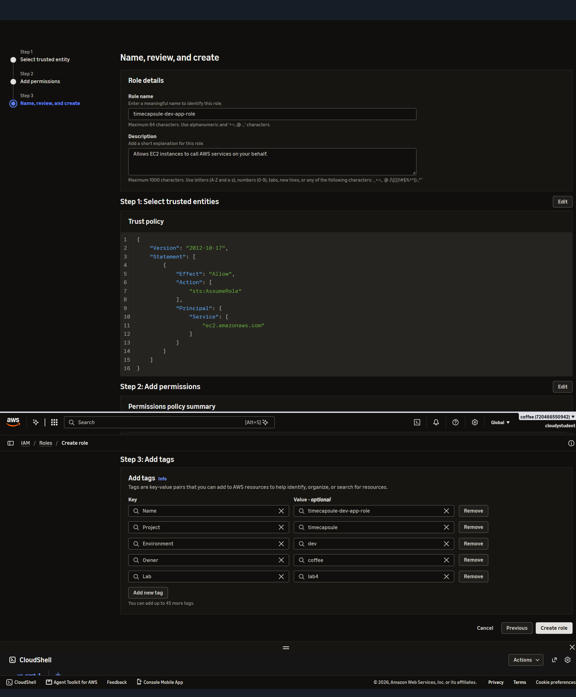
2. Привяжите роль к app-server. Запустите bastion, `db-server` и `app-server`, затем `EC2` → `Instances` → `timecapsule-dev-app` → `Actions` → `Security` → `Modify IAM role`. Перезапускать сервер не нужно.

3. Проверьте. Подключитесь к серверу (ssh app), сохраните имя бакета в ~/.bashrc, чтобы переменная была доступна и в следующих сеансах, и выполните проверку:
```cmd
всё верно?
[ec2-user@ip-10-21-0-36 ~]$ echo 'export BUCKET=timecapsule-dev-uploads-coffee' >> ~/.bashrc && source ~/.bashrc
[ec2-user@ip-10-21-0-36 ~]$ aws sts get-caller-identity
{
    "UserId": "AROA2PPZHECPPWCOYBEUH:i-00f607aa34c6cdcc7",
    "Account": "720466550942",
    "Arn": "arn:aws:sts::720466550942:assumed-role/timecapsule-dev-app-role/i-00f607aa34c6cdcc7"
}
[ec2-user@ip-10-21-0-36 ~]$
[ec2-user@ip-10-21-0-36 ~]$ aws s3 ls s3://$BUCKET/uploads/
                           PRE 2026/
2026-11-16 21:34:34          0
2026-11-16 21:52:38   10038416 Purple Dynamic Artificial Intelligence Presentation.pdf
2026-11-16 22:22:45      32112 jezva.jpg
2026-11-16 23:30:20          2 notes.txt
2026-11-16 22:06:08         18 photo.txt
2026-11-20 13:04:30         12 test.txt
[ec2-user@ip-10-21-0-36 ~]$ aws s3 ls s3://$BUCKET/backups/

aws: [ERROR]: An error occurred (AccessDenied) when calling the ListObjectsV2 operation: User: arn:aws:sts::720466550942:assumed-role/timecapsule-dev-app-role/i-00f607aa34c6cdcc7 is not authorized to perform: s3:ListBucket on resource: "arn:aws:s3:::timecapsule-dev-uploads-coffee" because no identity-based policy allows the s3:ListBucket action
```

>Откуда CLI взял учётные данные. Из сервиса метаданных экземпляра. Когда к EC2 привязана роль, AWS через профиль экземпляра выдаёт серверу временные ключи этой роли и обновляет их до истечения срока. CLI и SDK находят их автоматически, если не нашли ключей в переменных окружения и в ~/.aws.
>
>Чем отличается политика доверия. У тестовой роли доверенный — наш аккаунт (arn:aws:iam::720466550942:root), то есть роль могут взять пользователи аккаунта через sts:AssumeRole. У роли сервера доверенный — сервис ec2.amazonaws.com: роль может взять только экземпляр EC2, к которому она привязана, а человек напрямую её взять не может.
>
>Почему это безопаснее ключа в .env. Временные учётные данные действуют несколько часов и обновляются автоматически, поэтому украденные быстро перестают работать. Их нет ни в файлах, ни в репозитории, ни в образе диска, ни в снимке, так что случайно опубликовать их нельзя. Постоянный ключ из .env действует, пока его не удалят вручную, и уже попадал бы в образ и снимок, как пароль из ЛР2.

#### Задание 10. Перенос существующих файлов

1. Скопируйте файлы в бакет. На app-server сначала запустите синхронизацию в режиме проверки, затем по-настоящему. Для Laravel вместо storage/uploads укажите storage/app/uploads.

  ```cmd

  [ec2-user@ip-10-21-0-36 ~]$ cd /var/www/timecapsule/timecapsule
  [ec2-user@ip-10-21-0-36 timecapsule]$ aws s3 sync storage/uploads s3://$BUCKET/uploads/ --dryrun
  (dryrun) upload: storage/uploads/a78f395571595d7515f94ed3d833d129.jpg to s3://timecapsule-dev-uploads-coffee/uploads/a78f395571595d7515f94ed3d833d129.jpg
  [ec2-user@ip-10-21-0-36 timecapsule]$ aws s3 sync storage/uploads s3://$BUCKET/uploads/
  upload: storage/uploads/a78f395571595d7515f94ed3d833d129.jpg to s3://timecapsule-dev-uploads-coffee/uploads/a78f395571595d7515f94ed3d833d129.jpg
  [ec2-user@ip-10-21-0-36 timecapsule]$
  ```

2.  Проверьте результат. Повторите команду с --dryrun: пустой вывод означает, что все файлы уже в бакете. Проверьте Content-Type одного из перенесённых объектов.

```cmd
[ec2-user@ip-10-21-0-36 timecapsule]$ aws s3 sync storage/uploads s3://$BUCKET/uploads/ --dryrun
[ec2-user@ip-10-21-0-36 timecapsule]$
```

>Да, прав хватило: aws s3 sync выполнился без AccessDenied, хотя у роли сервера есть только политика timecapsule-dev-app-s3. Команда использовала два разрешённых действия:
>
  >1. s3:ListBucket. Перед копированием sync запрашивает список объектов под uploads/ (вызов ListObjectsV2 с prefix=uploads/), чтобы сравнить бакет с локальной папкой по имени, размеру и времени изменения. Запрос прошёл, потому что префикс uploads/ удовлетворяет условию s3:prefix = uploads/*.
  >2. s3:PutObject. Новые и изменённые файлы загружаются вызовом PutObject с ключами uploads/<имя>, что разрешено для ресурса arn:aws:s3:::timecapsule-dev-uploads-coffee/uploads/*.

### Задание 11. Модуль хранения на S3

1. Подключаем SDK в репозитории приложения командой `composer require aws/aws-sdk-php`. Если Composer установлен только на сервере, выполните команду там во временной копии репозитория и закоммитьте изменённые composer.json и composer.lock.

```powershell
PS D:\USM\III-st year\Cloud Computing> composer --version
Composer version 2.9.7 2026-04-14 13:31:52
PHP version 8.5.3 (C:\Program Files\php\php.exe)
Run the "diagnose" command to get more detailed diagnostics output.
PS D:\USM\III-st year\Cloud Computing> cd "D:\USM\III-st year\Cloud Computing\lab 2\timecapsule"
>> 
PS D:\USM\III-st year\Cloud Computing\lab 2\timecapsule> composer require aws/aws-sdk-php
./composer.json has been updated
Running composer update aws/aws-sdk-php
Loading composer repositories with package information
Updating dependencies
Lock file operations: 12 installs, 0 updates, 0 removals
```

2. Добавьте настройки в .env.example и в /var/www/timecapsule/.env на сервере:


3. Переписываем модуль хранения так, чтобы он работал только с S3. Кроме модуля, в приложении меняется только надпись в подвале страницы.

### Задание 12. Деплой и проверка

1. Выпустите новую версию своим способом из ЛР2 и ЛР3. Не забудьте выполнить composer install (в проекте появилась новая библиотека) и перезапустить приложение, как в ЛР3, чтобы оно прочитало новые настройки из .env.

   ```cmd
   [ec2-user@ip-10-21-0-36 timecapsule]$ cd timecapsule && composer install --no-dev --optimize-autoloader
    Installing dependencies from lock file
    Verifying lock file contents can be installed on current platform.
    Package operations: 12 installs, 0 updates, 0 removals
      - Downloading symfony/filesystem (v7.4.23)
      - Downloading psr/http-message (2.0)
      - Downloading mtdowling/jmespath.php (2.10.0)
      - Downloading symfony/polyfill-php82 (v1.43.0)
      - Downloading symfony/deprecation-contracts (v3.8.1)
      - Downloading psr/http-factory (1.1.0)
      - Downloading guzzlehttp/psr7 (3.5.1)
      - Downloading guzzlehttp/promises (3.2.0)
      - Downloading psr/http-client (1.0.3)
      - Downloading guzzlehttp/guzzle (8.5.4)
      - Downloading aws/aws-crt-php (v1.2.7)
      - Downloading aws/aws-sdk-php (3.407.1)
      - Installing symfony/filesystem (v7.4.23): Extracting archive
      - Installing psr/http-message (2.0): Extracting archive
      - Installing mtdowling/jmespath.php (2.10.0): Extracting archive
      - Installing symfony/polyfill-php82 (v1.43.0): Extracting archive
      - Installing symfony/deprecation-contracts (v3.8.1): Extracting archive
      - Installing psr/http-factory (1.1.0): Extracting archive
      - Installing guzzlehttp/psr7 (3.5.1): Extracting archive
      - Installing guzzlehttp/promises (3.2.0): Extracting archive
      - Installing psr/http-client (1.0.3): Extracting archive
      - Installing guzzlehttp/guzzle (8.5.4): Extracting archive
      - Installing aws/aws-crt-php (v1.2.7): Extracting archive
      - Installing aws/aws-sdk-php (3.407.1): Extracting archive
    Generating optimized autoload files
    12 packages you are using are looking for funding.
    Use the `composer fund` command to find out more!
    [ec2-user@ip-10-21-0-36 timecapsule]$ sudo systemctl reload php-fpm
   ```

   
2. Новые капсулы. Создайте капсулу с картинкой и капсулу с PDF. Время открытия укажите через 2-3 минуты: приложение не принимает время в прошлом, а вложение запечатанной капсулы не показывает.
   * Найдите новые объекты под uploads/ и проверьте их Content-Type.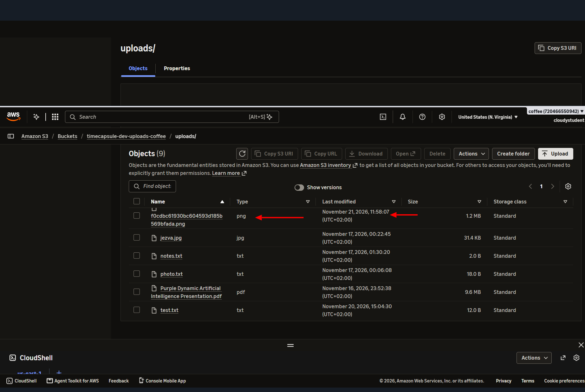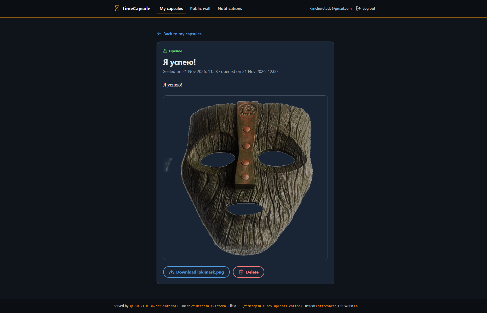
   * Когда капсулы откроются, откройте картинку в новой вкладке: в адресной строке должен оказаться адрес ...s3.eu-central-1.amazonaws.com/uploads/... с параметрами X-Amz-*. Скачайте PDF и проверьте, что он сохранился под исходным именем. 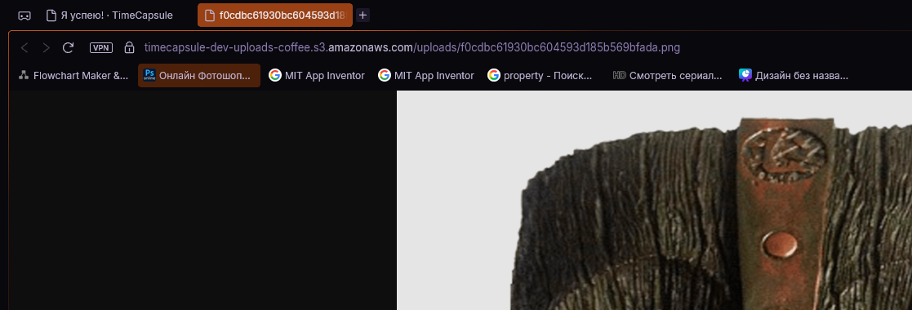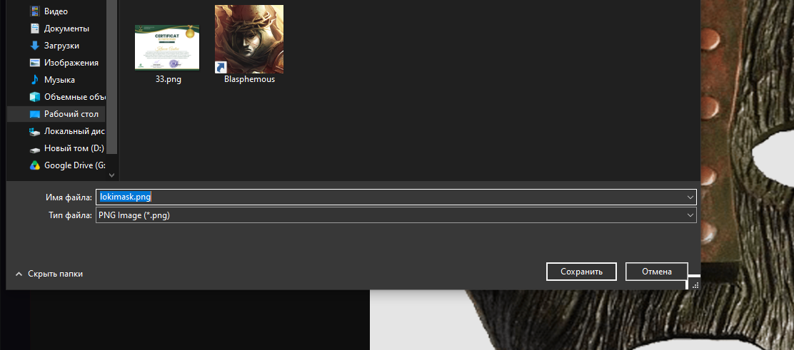
3. Срок ссылки. Скопируйте адрес картинки из адресной строки, подождите 5 минут и откройте его снова.
4. Удаление. Удалите капсулу с вложением и найдите её объект в консоли с включённым Show versions.

>Подписанный URL действует только 5 минут: срок входит в подпись, и после него S3 отвечает Request has expired, а изменить срок или ключ в ссылке нельзя без SignatureDoesNotMatch. Новые ссылки приложение выдаёт только владельцу, после проверки прав на капсулу, поэтому пересланная ссылка сама перестанет работать. Удаление капсулы вызвало deleteObject без версии, и S3 из-за версионирования не стёр файл, а положил маркер удаления, оставив сам файл неактуальной версией. По правилу жизненного цикла эта версия через 30 дней перейдёт в Standard-IA (если она не меньше 128 КБ), а через 90 дней удаляются неактуальные версии, кроме двух самых новых. У удалённого вложения неактуальная версия всего одна, поэтому при нашей настройке она не удалится автоматически и останется вместе с маркером, пока её не удалят вручную.

### Задание 13. Сервер без состояния

1. Уберите локальные файлы. На app-server переместите папку с вложениями во временное место: sudo mv /var/www/timecapsule/current/storage/uploads ~/uploads-backup

  ```cd
  [ec2-user@ip-10-21-0-36 ~]$ cd /var/www/timecapsule/
  [ec2-user@ip-10-21-0-36 timecapsule]$ cd timecapsule/
  [ec2-user@ip-10-21-0-36 timecapsule]$ ls
  Dockerfile  bin            composer.lock  deploy  docker-compose.yml  src      vendor
  README.md   composer.json  database       docker  public              storage  views
  [ec2-user@ip-10-21-0-36 timecapsule]$ cd storage/
  [ec2-user@ip-10-21-0-36 storage]$ ls
  sessions  uploads
  [ec2-user@ip-10-21-0-36 storage]$ sudo mv /var/www/timecapsule/timecapsule/storage/uploads ~/uploads-backup
  ```

2. Проверяем приложение. Открываем старые и новые капсулы, капсула показанная в предидущем примере по ошибке была удалена 😅, создём ещё одну с вложением. Всё работает, удаляем копию: sudo rm -rf ~/uploads-backup. Если нет, верните папку на место и найдите, какая часть кода всё ещё обращается к диску.
3. Уменьшите права. Приложению не нужен список объектов: s3:ListBucket использовала только команда aws s3 sync в задании 10.
     1. Создайте новую версию политики timecapsule-dev-app-s3 без правила с s3:ListBucket.
     2. Проверьте, что приложение по-прежнему работает, а команда aws s3 ls s3://$BUCKET/uploads/ на сервере получает AccessDenied.
      ```cmd
      [ec2-user@ip-10-21-0-36 ~]$ aws s3 ls s3://$BUCKET/uploads/

      aws: [ERROR]: An error occurred (AccessDenied) when calling the ListObjectsV2 operation: User: arn:aws:sts::720466550942:assumed-role/timecapsule-dev-app-role/i-00f607aa34c6cdcc7 is not authorized to perform: s3:ListBucket on resource: "arn:aws:s3:::timecapsule-dev-uploads-coffee" because no identity-based policy allows the s3:ListBucket action
      ```

4. Запросите несуществующий объект командой aws s3 cp s3://$BUCKET/uploads/no-such-file.txt - дважды: на сервере и в CloudShell под своим пользователем. Сравните ответы.
```cmd
aws s3 cp s3://timecapsule-dev-uploads-coffee/uploads/no-such-file.txt -
download failed: s3://timecapsule-dev-uploads-coffee/uploads/no-such-file.txt to - An error occurred (404) when calling the HeadObject operation: Not Found
```

```cmd
[ec2-user@ip-10-21-0-36 ~]$ aws s3 cp   s3://timecapsule-dev-uploads-coffee/uploads/no-such-file.txt -
download failed: s3://timecapsule-dev-uploads-coffee/uploads/no-such-file.txt to - An error occurred (403) when calling the HeadObject operation: Forbidden
```

>S3 вернул серверу 403 AccessDenied, поскольку IAM-роль приложения не имеет разрешения s3:ListBucket. CloudShell получил 404 Not Found, так как IAM-пользователь имеет это разрешение и S3 может подтвердить отсутствие объекта. Такое поведение защищает информацию о содержимом бакета от посторонних.
>>
>Чтобы заменить app-server, достаточно создать новый EC2-инстанс, привязать к нему IAM-роль timecapsule-dev-app-role, развернуть приложение и подключить его к тому же S3-бакету. Переносить вложения не нужно, поскольку они хранятся отдельно от сервера.

### Задание 14. Архитектура и решение

1. Компонент диаграмма решения 
2. Запишите решение в файл [docs/adr/0003-attachment-storage.md по шаблону ADR из ЛР2](docs/adr/0003-attachment-storage.md).

### Контрольные вопросы

#### **1. Как проходит запрос на скачивание вложения?**

Пользователь нажимает ссылку, приложение проверяет его права на доступ к капсуле и создаёт подписанный URL через AWS SDK. Браузер переходит по этой ссылке и скачивает файл напрямую из S3, минуя сервер приложения. На стороне S3 проверяются подпись URL, срок её действия и права IAM-роли сервера, от имени которой была создана ссылка.

#### **2. Какие настройки бакета и свойства подписанного URL защищают вложения?**

В бакете включён Block Public Access, отсутствует публичный доступ, а политика запрещает запросы без HTTPS. Подписанный URL содержит криптографическую подпись, привязанную к конкретному объекту и сроку действия (5 минут), поэтому нельзя изменить ключ объекта или использовать ссылку после истечения срока.

#### **3. Почему приложение отдаёт файлы через подписанный URL, а не открывает бакет для чтения всем?**

Подписанные URL позволяют предоставлять временный доступ только к конкретному файлу, не открывая весь бакет посторонним. При этом файлы скачиваются напрямую из S3, что снижает нагрузку на сервер приложения и упрощает масштабирование.

#### **4. Как изменится схема, если вложения должны пережить отказ всего региона eu-central-1?**

Нужно настроить репликацию объектов S3 в другой регион AWS, например `us-east-1`, и обеспечить копирование версий объектов. При отказе основного региона приложение должно переключиться на резервный бакет, используя его регион и соответствующие настройки доступа. Для автоматического переключения потребуется дополнительно настроить механизм обнаружения отказа и маршрутизации запросов.